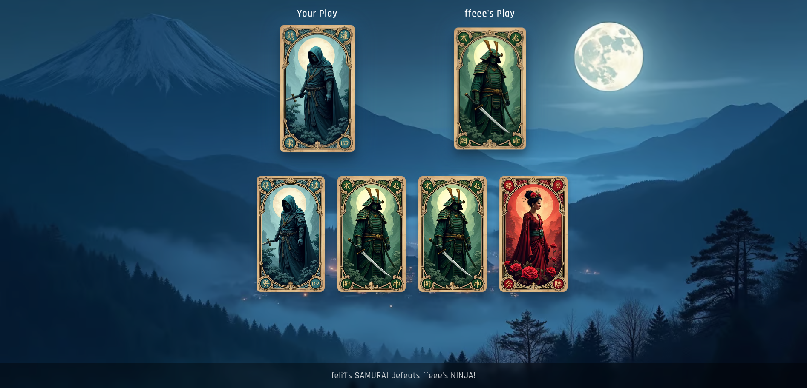

# Kyoki



Kyoki is a two-player browser card game with fast rounds, simple rules, and a dramatic reveal. It is basically a japan-themed version of the original game "Coup de Grace", also known as "King, Knight, Assassin".

It runs on FastAPI with WebSocket matchmaking and a static front end.

## Gameplay

- Each player has one Empress, two Samurai, and two Ninja cards.
- Reveal is simultaneous.
- Matchups:
  - Empress defeats Samurai
  - Samurai defeats Ninja
  - Ninja defeats Empress
- A match ends when the Empress is defeated.

## Modes

- Arena: queue up and get matched with a random opponent.
- VS Battle: generate a 6-letter code and play with a friend.

## Tech Stack

- FastAPI + Uvicorn for the server
- WebSockets for realtime play
- Jinja2 templates + vanilla HTML/CSS/JS

## Operational Note

Kyoki runs with a single FastAPI worker in production. Matchmaking and VS battle
codes are kept in memory, as this is a small toy project rather than a
commercial game. A single worker keeps the behavior predictable without adding
external state.

## Running Locally

Kyoki has no external dependencies: no database, no network or services to set
up first.

With Docker (hot reload, source mounted):

```bash
make run-dev
```

Without Docker (Python 3.11+):

```bash
python3 -m venv .venv
.venv/bin/pip install -r requirements.txt
.venv/bin/uvicorn app.main:app --reload --port 1337
```

Then open `http://localhost:1337`. To play against yourself, open a second
browser window.

## Production

```bash
make run    # builds the image if needed, starts it detached
make logs
make stop
```

The production container listens on `127.0.0.1:1337` only; put a reverse proxy
in front of it that forwards WebSockets (`Upgrade`/`Connection` headers).

## Configuration

All optional, read from the host environment by `docker-compose.yml`:

| Variable | Default | Meaning |
| --- | --- | --- |
| `KYOKI_PORT` | `1337` | Host port of the production container |
| `KYOKI_DEV_PORT` | `1337` | Host port of the dev container |
| `KYOKI_LOG_LEVEL` | `INFO` | Python log level |
| `KYOKI_WEBSOCKET_IDLE_TIMEOUT` | `90` | Seconds before an idle socket is dropped |

## Project Layout

- `app/main.py`: FastAPI app and game logic
- `app/templates/index.html`: UI and client logic
- `app/static/`: styles, images, and celebration effects

## License

MIT. See `LICENSE`.